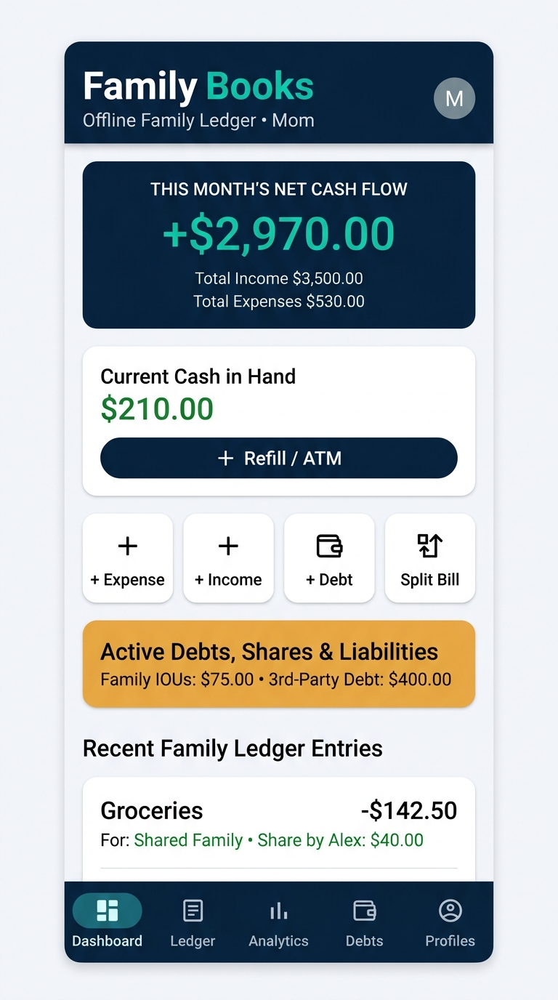
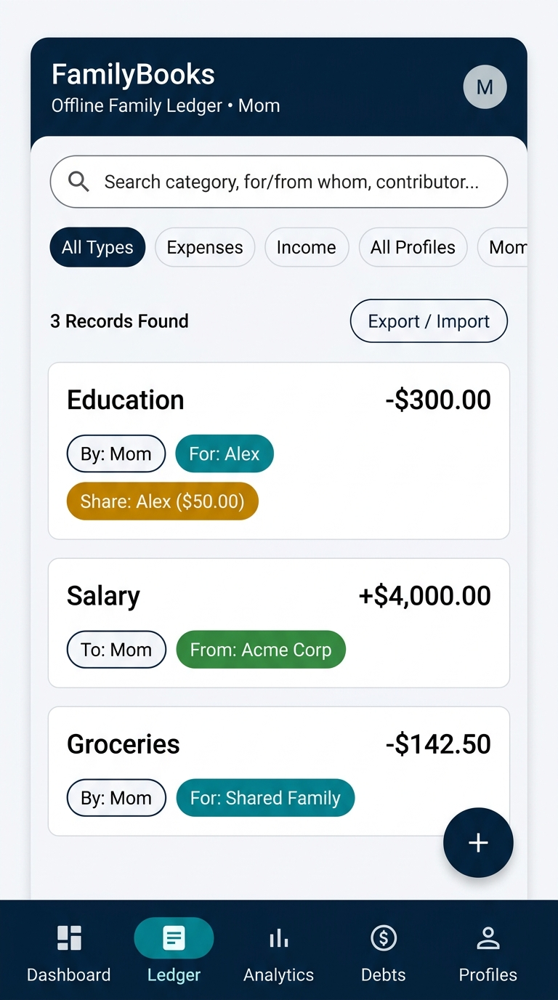
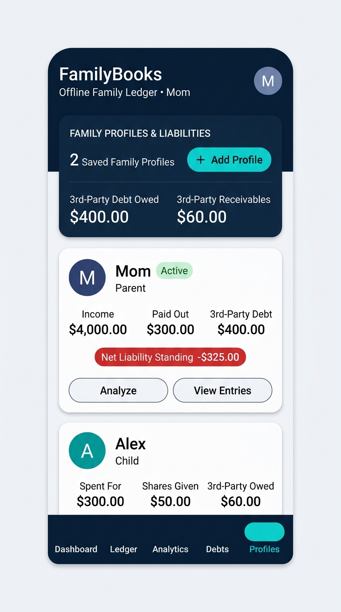
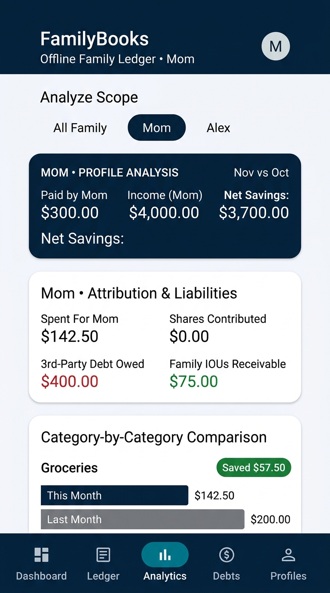
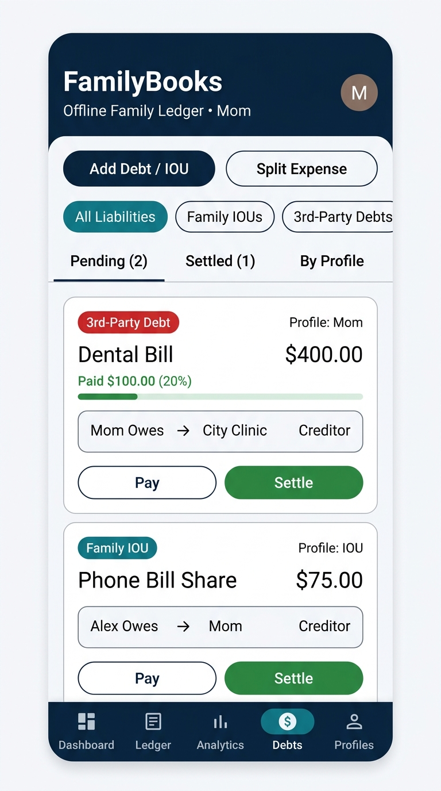

# FamilyBooks

**FamilyBooks** is a **100% offline individual-family ledger** Android application built with Kotlin, Jetpack Compose, Material 3, and Room. It enables a household to manually maintain expenses, income, cash-in-hand wallet balances, family profiles, share contributions, and both intra-family and third-party debts completely offline with zero network permissions or cloud accounts.

---

## Screenshots

| Dashboard | Family Ledger | Family Profiles |
| :---: | :---: | :---: |
|  |  |  |
| Net cash flow, wallet pool & quick actions | Searchable ledger with attribution & share badges | Per-profile cashflow, IOUs & 3rd-party debt cards |

| Profile & MoM Analytics | Debts, Shares & 3rd-Party Liabilities |
| :---: | :---: |
|  |  |
| Whole-family & individual-profile MoM comparisons | Track family IOUs, partial repayments & 3rd-party debts |

---

## Key Features

- **100% Offline & Clean Start**:
  - Zero network or Wi-Fi permissions—all data stays privately in the local Room database on your device.
  - Starts completely empty on first launch (no sample data, no pre-filled profiles, `$0.00` cash baseline). Every record is entered manually.
- **Family Profiles & Per-Profile Analysis**:
  - Create, edit, and remove individual family profiles (e.g., *Mom*, *Dad*, *Alex*) with roles, custom avatar colors, and active-profile selection via the fixed top-right profile icon or the **Profiles** tab.
  - Inspect each profile's total income, expenses paid, expenses spent *for* them, shares contributed/received, family IOUs, and third-party debts.
- **Detailed Manual Entry Attribution & Shares**:
  - **Expense**: Record who paid (`Paid By`), who it was **for** (`For Whom` — specific member, *Shared Family*, or custom), and optional **Share / Contribution by Other** (`Contributed By` + share amount).
  - **Income**: Record who received it (`Received By`), **from whom / source** (`From Whom` — employer, freelance client, member, refund, or third party), and optional shared contribution.
- **Third-Party Debts & Family IOUs (`Debts` Tab)**:
  - Maintain **Family IOUs** (between family members), **3rd-Party Debts** (money owed to banks, landlords, clinics, friends, vendors), and **3rd-Party Receivables** (money owed to a family profile by external parties).
  - Link each third-party liability to an individual family profile for per-profile liability analysis.
  - Supports **partial repayments** (`Pay`) as well as one-tap full settlement (`Settle`) and **Split Bill** across multiple profiles.
- **Whole-Family & Individual Profile Analytics (`Analytics` Tab)**:
  - Filter Month-on-Month (MoM) comparisons by **All Family** or any **individual profile** to analyze income, spending paid vs. spent-for, shares contributed, category trends, and payment methods.
- **Year & Month Backup (`Export / Import`)**:
  - Export and import ledgers for a **Full Year**, a **Particular Month**, or **Multiple Selected Months** of the same year in **JSON** (full entries, liabilities & profiles) or **CSV** (spreadsheet-compatible).

---

## Usage Guide

### 1. Create Family Profiles
1. Tap the top-right profile icon or open the **Profiles** tab.
2. Tap **Add Profile**, enter the member's name, choose a role (*Self*, *Spouse*, *Parent*, *Child*, etc.) and avatar color, and save.
3. Tap any profile card to set it as the active default when recording new entries.

### 2. Log Expenses, Income & Shares
- Tap **+ Expense** or **+ Income** on the **Dashboard** (or **+** in the **Ledger** tab).
- Choose **Paid By / Received By**, set **For Whom** (for expenses) or **From Whom** (for income), and optionally toggle **Share / Contribution by Other** to record a share covered by another member or third party.
- Entries paid in **Cash** automatically update **Current Cash in Hand**; use **+ Refill / ATM** to add cash or adjust your wallet baseline.

### 3. Track Family IOUs & Third-Party Debts
- Open the **Debts** tab and tap **Add Debt / IOU**:
  - **Family IOU**: Track money owed between family profiles.
  - **3rd-Party Debt**: Track debts owed by a family profile to an external lender, bank, landlord, clinic, or friend.
  - **3rd-Party Owed**: Track money an external party owes back to a family profile.
- Tap **Pay** on any pending liability to apply a partial payment or **Settle** to mark it fully paid.

### 4. Analyze by Individual Profile
- Open the **Analytics** tab and tap any profile chip at the top (*All Family*, *Mom*, *Alex*, etc.), or tap **Analyze** directly on a profile card in the **Profiles** tab.

### 5. Export & Import Ledgers
- Open **Export / Import** from the **Ledger** or **Profiles** tab to back up or restore a **Full Year**, **Particular Month**, or **Selected Months** in **JSON** or **CSV** format.

---

## Architecture & Tech Stack

- **Language**: Kotlin
- **UI**: Jetpack Compose + Material Design 3
- **Local Persistence**: Room Database (`transactions`, `family_invoices`, `family_members`) with Coroutines & `Flow`
- **State Management**: MVVM (`FamilyBooksViewModel` + `StateFlow` + `collectAsStateWithLifecycle`)

### Project Structure

```text
app/src/main/java/com/example/
├── MainActivity.kt
├── data/
│   ├── local/          # Room Database & DAOs
│   ├── model/          # Room Entities & ProfileFinancialSummary
│   ├── repository/     # FamilyBooksRepository (CRUD, Liabilities, Per-Profile Aggregation)
│   └── util/           # LedgerExportImportManager (JSON/CSV)
├── ui/
│   ├── FamilyBooksApp.kt
│   ├── components/     # TopAppBarHeader
│   ├── dialogs/        # Transaction, Debt/IOU, Split, Refill Cash, Add/Edit Profile, Export/Import
│   ├── screens/        # Dashboard, Ledger, Analytics, Debts (InvoicesScreen), Profiles
│   ├── theme/          # Color, Typography, Theme
│   └── util/           # FormatUtils
└── viewmodel/          # FamilyBooksViewModel
docs/
└── screenshots/        # App screenshots used in this README
```

---

## Building & Testing

Build the debug APK:

```bash
gradle :app:assembleDebug
```

Run local JVM unit tests:

```bash
gradle :app:testDebugUnitTest
```
